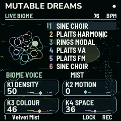

# mdsmk

[Mutable Dreams](https://github.com/kidbee85-beep/mutable-dreams) by **Kid Bunka**, built by CI for the M-VAVE FM-1 and the M-VAVE SMK-37.



This is a fork. The instrument, its sounds and its manual are Kid Bunka's: see the [original repository](https://github.com/kidbee85-beep/mutable-dreams) for what it does and how to play it. Its browser editor and installer work with these builds too. This repository only keeps the source, builds every release in GitHub Actions, and adds builds for the SMK-37.

## Install

Install from the browser (Chrome or Edge, over USB) at [mutant.cloud](https://mutant.cloud/?q=mdsmk). It asks the device what it is and picks the right package. To go back to stock firmware, use [mutant.cloud/rescue](https://mutant.cloud/rescue).

Every release's packages are also attached to its [GitHub release](https://github.com/konsumer/mdsmk/releases).

## Build

Everything runs in the [foma toolchain image](https://hub.docker.com/r/konsumer/foma-toolchain) (the JieLi toolchain and AC79 SDK):

```sh
docker run --rm --platform linux/amd64 -u "$(id -u):$(id -g)" -v "$PWD:/work" konsumer/foma-toolchain \
  sh -c 'pip3 install -q --user --break-system-packages pillow && sh tools/build_device.sh'
```

The package lands in `app/build/`. `VERSION=1.4.0-smk1` sets the release version (the device ID stays `FM-1_710` plus the version's digits). See [BUILDING.md](BUILDING.md) for the native and browser builds.

Pushing a `v*` tag builds a release, attaches its packages and updates the [mutant.cloud](https://mutant.cloud) listing.

## Licence

GPL-3.0-only, as the original: see [LICENSE](LICENSE) and [LICENSING-GPL.txt](LICENSING-GPL.txt). The original MIT and MPL-2.0 notices of Mutable Instruments, fm1-base and felucca-bsp are kept with their code.
